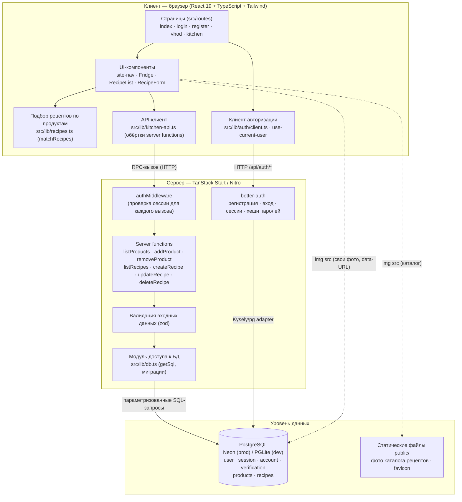

# Диаграмма компонентов

Приложение построено по трёхуровневой клиент-серверной архитектуре:
браузерный SPA-клиент (React), серверный слой TanStack Start (server
functions + better-auth) и уровень данных (PostgreSQL). Клиент и сервер
живут в одном пакете: «server functions» вызываются из компонентов как
обычные функции, а выполняются на сервере.

## Описание компонентов

| Компонент | Зона ответственности |
| --- | --- |
| **Страницы (src/routes)** | Маршрутизация (TanStack Router): лендинг, вход/регистрация, «Кухня» с вкладками Холодильник / Рецепты / Свой рецепт |
| **UI-компоненты** | Отображение и ввод данных: форма продукта, лента карточек рецептов, форма рецепта (ингредиенты с количеством, фото, КБЖУ) |
| **matchRecipes** | Клиентский алгоритм ранжирования рецептов по совпадению ингредиентов с продуктами пользователя |
| **Клиент авторизации** | Сессия текущего пользователя, редиректы неавторизованных пользователей (gates) |
| **API-клиент** | Типизированные обёртки server functions; единая точка вызова CRUD-операций |
| **authMiddleware** | Серверная проверка сессии: каждый вызов API получает `context.userId` или отклоняется |
| **Server functions** | Бизнес-логика CRUD: продукты и рецепты; изоляция данных по `user_id` |
| **Валидатор (zod)** | Схемы входных данных: строки, числа, массив ингредиентов, data-URL фото |
| **better-auth** | Регистрация, вход, управление сессиями и хешами паролей |
| **Модуль БД (getSql)** | Выбор бэкенда (Neon / PGLite), применение миграций, параметризованные запросы |
| **PostgreSQL** | Хранилище пользователей, сессий, продуктов и рецептов (включая фото как data-URL) |
| **Статические файлы** | Фото каталога рецептов и прочие публичные ресурсы |
