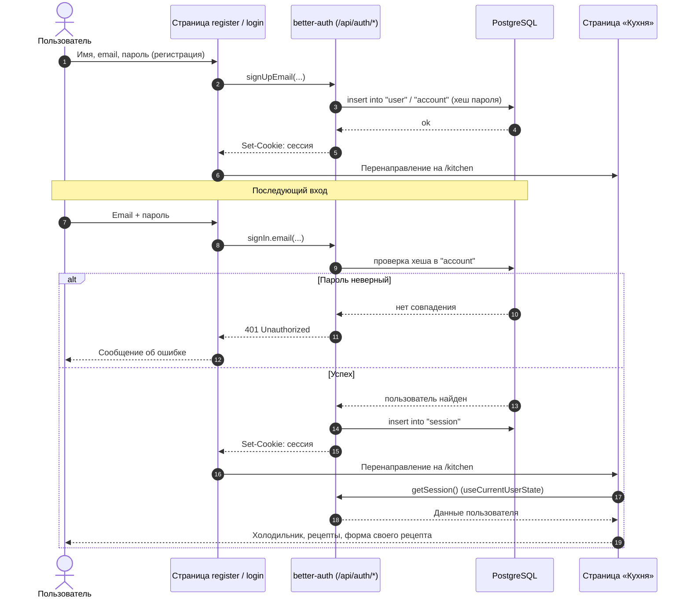
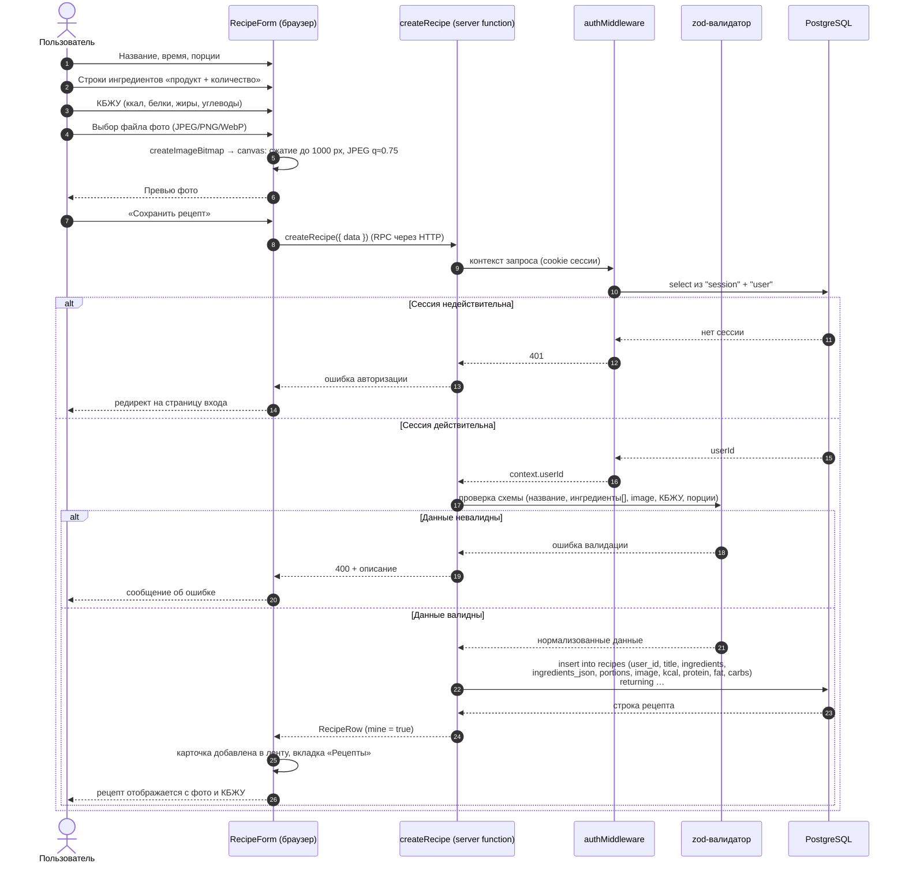

# Диаграммы последовательностей

## 1. Регистрация и вход пользователя



## 2. Создание своего рецепта (фото + ингредиенты + КБЖУ)



## 3. Подбор рецептов по «Холодильнику» (клиентская логика)

```mermaid
sequenceDiagram
  autonumber
  actor U as Пользователь
  participant K as Страница «Кухня»
  participant API as listProducts / listRecipes (server functions)
  participant DB as PostgreSQL
  participant M as matchRecipes (клиент)

  U->>K: Открытие вкладки «Рецепты»
  K->>API: listProducts(), listRecipes() — параллельно
  API->>DB: select продуктов по user_id;<br/>select каталога (user_id is null) + своих рецептов
  DB-->>API: строки
  API-->>K: ProductRow[], RecipeRow[]
  K->>M: matchRecipes(recipes, productNames)
  M->>M: подсчёт совпадений ингредиентов,<br/>сортировка по числу совпадений
  M-->>K: упорядоченный список
  K-->>U: сначала блюда из имеющихся продуктов
```
